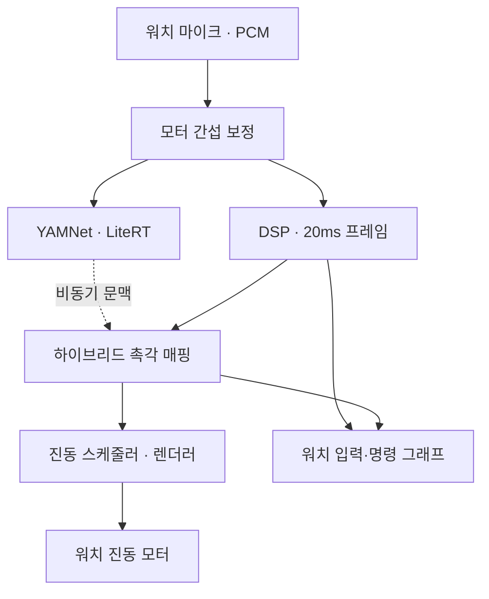

<div align="center">
  

  <h1>울림 (ULLIM)</h1>
  <p><strong>소리를 듣는 또 하나의 방법.</strong></p>
  <p>주변의 소리를 손목의 촉각으로 전달하는 스마트워치 기반 청각 접근성 프로젝트</p>

  
  
  
  <a href="LICENSE"></a>

  <p>단국대학교 EASYTHON 2026 · AI를 활용한 사회문제 해결</p>
  <p><a href="#프로젝트-소개">프로젝트 소개</a> · <a href="#주요-기능">주요 기능</a> · <a href="#시스템-아키텍처">아키텍처</a> · <a href="#빌드-및-설치">설치</a> · <a href="#팀원">팀원</a></p>
</div>

## 프로젝트 소개

주변 소리를 듣기 어렵거나 화면을 계속 확인하기 어려운 상황에서도 소리의 변화를 손목에서 느낄 수 있다면 어떨까요?

울림은 갤럭시 워치7의 마이크 입력을 진동의 강약·지속시간·간격으로 변환하는 해커톤 MVP입니다. 소리의 종류마다 고정된 알림을 울리는 대신 실제 음향의 변화에 대응하며, AI는 연속적인 음향 문맥에 대한 제한적인 보정에 사용됩니다. 스마트워치 자체에서 감지·추론·출력이 이루어지므로 기본 동작에 휴대폰·서버·인터넷이 필요하지 않습니다.

> 해커톤 MVP 기준: 2026년 11월 14일, [PR #86](https://github.com/chlgusrbs0/ullim/pull/86)의 런타임 커밋 `6424683`. 실제 대상 사용자의 효과 및 안전성은 정식 검증되지 않았습니다. 의료기기나 안전 경보의 대체 수단이 아닙니다.

## 주요 기능

| 기능 | 설명 |
| --- | --- |
| 소리의 촉각화 | 음량·엔벌로프·시작 변화를 분석해 진동 요청의 강약·길이·간격으로 변환합니다. |
| 워치 단독 실행 | 사용자가 감지를 시작하고 화면을 끈 뒤에도 동작하는 서비스를 구성했습니다. |
| 온디바이스 AI | 번들 YAMNet으로 환경음을 분류하고 신뢰 가능한 같은 문맥의 작은 출력 변화를 보정합니다. |
| 입력·출력 시각화 | 워치에서 소리의 특징과 진동 **명령값**을 비교하고 AI 후보·모델 점수·적용 상태를 확인합니다. |
| 세부 조절 | 워치 또는 선택적인 동일 Wi-Fi 브라우저에서 감지·출력 설정을 조절하고 저장합니다. |
| 모터 간섭 보정 | 워치 자체 진동이 마이크에 다시 유입되는 현상을 줄이기 위한 착용 보정을 제공합니다. |

## 기술 스택

| 기술 | 적용 목적 |
| --- | --- |
| Kotlin · Wear OS | 워치 단독 실행, 마이크·진동 제어 및 생명주기 관리 |
| Wear Compose Material 3 | 원형 화면에 적합한 사용자 인터페이스 |
| AudioRecord · DSP | 20ms 프레임 단위 RMS·엔벌로프·온셋 처리 |
| YAMNet · LiteRT 1.4.2 | 521개 환경음 범주를 분류하는 사전학습 모델의 기기 내 실행 |
| Kotlin Coroutines | 기본 신호 처리와 AI 추론의 실행 경계 분리 |
| Preferences DataStore | 사용자 설정의 로컬 저장·복원 |

## 시스템 아키텍처



AI는 기본 DSP 처리를 차단하지 않습니다. 첫 반응, 큰 변화, 소리 종료는 AI 추론을 기다리지 않으며 AI가 늦거나 실패해도 DSP 경로는 유지됩니다. 최종 기본값에서 AI의 작은 출력 조정은 기본 요청 대비 최대 3%포인트입니다.

원본 PCM과 음성 파일은 저장하거나 외부로 전송하지 않습니다. 선택적인 브라우저 조절 통로는 설정과 상태 수치만 주고받습니다. 그래프는 실제 모터 가속도나 물리 진폭의 측정값이 아닙니다.

[최종 구현 구조 및 초기 설계 기록](docs/architecture.md) · [모델과 추론 정책](docs/models.md)

## 기술적 문제 해결

### 자기 진동과 마이크 간섭

진동 모터의 출력이 마이크 입력에 섞일 수 있으므로 조용한 착용 상태에서 보정 프로필을 만들고 입력 처리에 사용합니다. [모터 간섭 및 외부음 보존 평가](https://github.com/chlgusrbs0/ullim/issues/17)

### 실기기 진동 제어의 한계

Watch7에서 API의 강도 제어 지원 표시만으로 실제 강약 차이를 보장할 수 없었습니다. 관찰한 기기 제약에 대응하기 위해 펄스의 켜짐·꺼짐 시간으로 요청 강도를 표현합니다. 물리 진폭을 연속적으로 제어하거나 측정했다고 주장하지 않습니다. [촉각 검증 기록](docs/watch-haptic-validation.md)

### 실시간 신호 처리와 AI의 분리

AI 추론이 느려지거나 실패하는 경우에도 DSP의 직접 촉각화 경로를 유지합니다. 환경음 분류 결과는 신뢰 가능한 연속 문맥에서 제한적인 보조 수단으로만 사용합니다. [AI 실행 및 평가](docs/ai-runtime-validation.md)

## 검증 결과 및 한계

| 항목 | 기존 확인 범위 |
| --- | --- |
| 실제 기기 | 갤럭시 워치7에서 설치·시작·중지·소리 감지·펄스 출력·설정 저장 기록 |
| AI | 실제 워치의 추론 및 진동 요청 보정 기록 |
| 로컬 검사 | 최종 기본값 작업에서 기존 289개 검사 통과 후 수정된 신규 4개 검사 통과; 전체를 다시 실행한 기록은 아님 |
| 최종 설정 | 35개 수치, 민감도 125%, AI 켜짐; 업데이트 설치 전후 기존 설정과 보정 보존 확인 |

[최종 기본값 및 설치 기록](docs/evidence/final-mvp-defaults.md) · [실제 AI 조절 기록](docs/evidence/live-detailed-tuning.md) · [프로젝트 현황](docs/project-status.md)

정식 블라인드 촉각 구별률, 물리적 반응 지연 P95, 통제된 AI 켜짐/꺼짐 효과 비교는 완료되지 않았습니다. 검증한 기기는 Watch7이며 다른 기기의 호환성을 보장하지 않습니다. 음원 분리, 음성 내용 인식, 특정 사람 추적 또는 발소리 선택 제거 기능도 제공하지 않습니다.

## 빌드 및 설치

JDK 17 이상, Android SDK 36 및 ADB를 준비합니다. 실제 검증 기기는 Galaxy Watch7이며 무선 디버깅을 켜고 ADB 페어링을 완료해야 합니다.

```bash
./gradlew :app:assembleDebug
adb connect <워치_IP:연결_포트>
adb install -r app/build/outputs/apk/debug/app-debug.apk
```

Windows에서는 `gradlew.bat`를 사용합니다. ADB 페어링 포트와 연결 포트는 다를 수 있으며 브라우저 조절 포트와도 구분합니다. 여러 기기가 연결된 경우 `adb -s <기기_식별자>`로 설치 대상 워치를 지정합니다. `-r`은 기존 앱 데이터와 서명이 호환되는 경우에 사용합니다. APK 파일은 별도로 공개 배포하지 않습니다.

### 사용 방법

1. 울림 앱에서 안내와 권한을 확인하고 **소리 감지 시작**을 누릅니다.
2. 필요하면 워치를 착용하고 조용한 곳에서 3초간 모터 간섭 보정을 합니다.
3. 소리 변화에 따른 손목 진동을 사용합니다. 필요 시 워치 그래프와 AI 분석, 실시간 조절 화면을 확인합니다.
4. 앱 또는 작동 알림에서 **중지**를 누릅니다. AI를 켜거나 앱을 열기만 해서는 마이크가 시작되지 않습니다.

[개발 환경 및 로컬 검사](docs/development.md) · [실시간 설정 조절](docs/live-tuning.md)

## 기술 문서

- [문서 안내](docs/README.md) — 현재 구현, 기술 설명, 검증 기록, 과거 개발 계획
- [아키텍처](docs/architecture.md) — 처리 구조와 설계의 변화
- [프로젝트 현황](docs/project-status.md) — 구현 완료, 후속 평가, 보류 구분
- [검증 기록](docs/evidence/final-mvp-defaults.md) — 최종 설정과 설치 근거

## 팀원

<div align="center">
<table>
  <tr>
    <td align="center"><a href="https://github.com/chlgusrbs0"><br>최현균</a></td>
    <td align="center">김정민</td>
    <td align="center">문지원</td>
    <td align="center"><a href="https://github.com/future6026"><br>박민후</a></td>
  </tr>
</table>
</div>

## 라이선스

울림의 자체 작성 코드는 [MIT 라이선스](LICENSE)를 적용합니다. 번들 YAMNet 모델, LiteRT 및 기타 외부 구성요소는 각자의 기존 라이선스가 적용됩니다. [모델 출처 및 고지](docs/models.md), [번들 고지](app/src/main/assets/notices/Apache-2.0.txt)를 참고하세요. 외부 구성요소 전체 고지 감사는 [#34](https://github.com/chlgusrbs0/ullim/issues/34)에 남아 있습니다.
