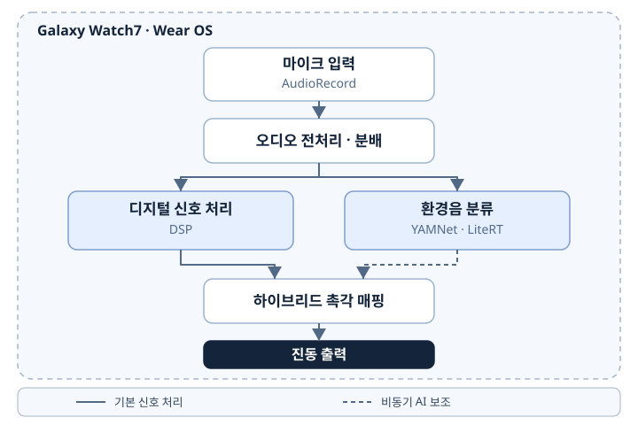

<div align="center">
  

  <h1>울림 (Ullim)</h1>
  <p><strong>소리를 듣는 또 하나의 방법.</strong></p>
  <p>주변의 소리를 손목의 촉각으로 전달하는 스마트워치 기반 청각 접근성 프로젝트</p>

  
  
  
  

  <p>단국대학교 EASYTHON 2026 · AI를 활용한 사회문제 해결</p>
</div>

## 프로젝트 소개

울림은 주변 소리를 듣기 어려운 상황에서 음향의 변화를 손목으로 느낄 수 있도록 개발한 Wear OS 앱입니다.

갤럭시 워치7의 마이크로 주변 소리를 감지하고, 소리의 강약·지속시간·리듬을 진동으로 변환합니다. 환경음 분류 AI는 기본 신호 처리에 보조적으로 사용되며, 감지부터 추론과 진동 출력까지 워치 자체에서 수행합니다.

## 주요 기능

- **소리의 촉각화:** 소리의 강약·지속시간·리듬에 따라 진동을 변환합니다.
- **워치 단독 실행:** 휴대폰이나 서버 없이 소리 감지와 진동 출력을 수행합니다.
- **온디바이스 AI:** YAMNet으로 환경음을 분류하고, 연속적인 음향 문맥에 따라 진동 요청을 보정합니다.
- **실시간 시각화:** 소리의 특징과 진동 명령, AI 분석 상태를 확인합니다.
- **개인별 설정:** 민감도와 진동 특성을 워치 또는 같은 Wi-Fi의 브라우저에서 조절하고 저장합니다.

## 기술 스택

| 기술 | 역할 |
| --- | --- |
| Kotlin · Wear OS | 스마트워치 앱 개발 및 기기 제어 |
| Wear Compose Material 3 | 원형 워치 사용자 인터페이스 |
| AudioRecord · DSP | 오디오 입력 및 디지털 신호 처리 |
| YAMNet · LiteRT | 환경음 분류 모델 및 온디바이스 추론 |
| Kotlin Coroutines | 신호 처리와 비동기 AI 추론 |
| Preferences DataStore | 사용자 설정 저장 및 복원 |

## 시스템 아키텍처

<div align="center">
  
</div>

DSP는 기본 촉각 변환을 담당하고, AI는 유효한 환경음 문맥을 보조적으로 제공합니다. AI 추론이 지연되거나 실패해도 기본 진동 처리 경로는 유지됩니다.

## 핵심 기술적 문제 해결

| 문제 | 해결 방식 |
| --- | --- |
| 모터 간섭 | 워치의 자기 진동이 마이크에 유입되는 현상을 줄이기 위해 착용 보정과 입력 전처리를 적용했습니다. |
| 진동 제어 제약 | 실기기에서 관찰한 강도 제어 한계에 대응하여 펄스의 켜짐·꺼짐 시간을 조절합니다. |
| AI 추론 지연 | DSP와 AI 추론 경로를 분리해 기본 촉각 변환이 추론 완료를 기다리지 않도록 설계했습니다. |

## 구현 및 검증

갤럭시 워치7에서 앱 설치, 감지 시작·중지, 소리 감지, 진동 출력, AI 추론 및 설정 저장을 확인했습니다. 원본 음성은 저장하거나 외부로 전송하지 않습니다.

화면의 진동 그래프는 실제 모터 진폭이 아니라 출력 명령을 나타냅니다. 정식 촉각 구별률, 물리적 반응 지연, AI 보정 효과에 대한 통제 평가 및 대상 사용자 효과 검증은 완료되지 않았습니다.

## 빌드 및 설치

JDK 17 이상, Android SDK 36, ADB를 준비하고 워치에서 무선 디버깅을 활성화합니다.

```bash
./gradlew :app:assembleDebug
adb pair WATCH_IP:PAIR_PORT
adb connect WATCH_IP:CONNECT_PORT
adb -s WATCH_IP:CONNECT_PORT install -r app/build/outputs/apk/debug/app-debug.apk
```

`WATCH_IP`, `PAIR_PORT`, `CONNECT_PORT`는 워치에 표시되는 실제 주소와 포트로 대체합니다. 이미 페어링했다면 페어링 단계는 생략합니다. Windows에서는 `gradlew.bat`를 사용합니다. 자세한 내용은 [개발 및 설치 안내](docs/development.md)를 참고하세요.

설치한 앱에서 권한을 허용한 뒤 **소리 감지 시작**을 누릅니다. 필요한 경우 조용한 곳에서 착용 보정을 진행합니다. 사용을 마치면 앱이나 작동 알림에서 중지합니다.

## 기술 문서

아키텍처 상세 설명, 모델 정보, 개발 환경과 검증 기록은 [기술 문서 안내](docs/README.md)에서 확인할 수 있습니다.

## 팀원

<div align="center">
  <table>
    <tr>
      <td align="center"><a href="https://github.com/chlgusrbs0"><br>최현균</a></td>
      <td align="center"><a href="https://github.com/nemodx"><br>김정민</a></td>
      <td align="center"><a href="https://github.com/bondy8807"><br>문지원</a></td>
      <td align="center"><a href="https://github.com/future6026"><br>박민후</a></td>
    </tr>
  </table>
</div>

## 라이선스

울림의 자체 작성 코드는 [MIT 라이선스](LICENSE)를 적용합니다. 외부 모델과 라이브러리는 각자의 기존 라이선스를 따릅니다.
