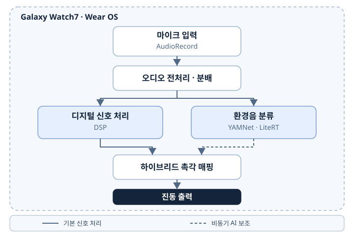

# 시스템 아키텍처

[문서 안내](README.md)

최종 해커톤 MVP의 구현과 초기 설계 계약을 구분한다. 검증 결과와 미완료 범위는 [프로젝트 현황](project-status.md)에 정리했다.

<div align="center">
  
</div>

## 최종 MVP 구현 요약

- 워치의 마이크 입력을 모터 간섭 보정한 뒤 DSP와 비동기 YAMNet/LiteRT 경로에 전달한다. 기본 20ms DSP 경로는 AI를 기다리지 않는다.
- 소리 강약·지속·리듬을 촉각 요청으로 변환하며, 같은 문맥의 작은 변화만 최대 3%포인트 보정한다. Watch7에서는 펄스 폴백을 사용한다.
- 워치 단독 감지와 설정 저장을 제공한다. 선택적으로 같은 Wi-Fi의 브라우저에서 설정과 상태 수치를 주고받는 조절 통로가 추가되었다. 원본 오디오의 저장·전송은 하지 않는다. 휴대폰이나 노트북은 기본 감지에 필수가 아니다.
- 최종 기본값은 35개 수치와 민감도 125%, AI ON이며 유효한 기존 설정은 보존된다. [설정](persistent-settings.md) · [실시간 조절](live-tuning.md) · [모델](models.md)
- 물리 진폭·지연과 블라인드 구별, 통제 AI 효과는 별도 평가다.

## 초기 설계 계약 (보존)

아래는 초기 설계와 후속 모듈 계약을 보존한 기록이다. 당시 목표·초기값은 최종 구현 사실이나 성능으로 해석하지 않는다. 현재 기본값은 MvpDefaults를 따른다.

## 1. 목표와 비목표

- 목표: 갤럭시 워치7 단독으로 소리의 **실제 강약·리듬·지속시간**을 촉각으로 변환하고, 입력과 출력 명령의 변화를 화면에서 비교할 수 있도록 한다.
- 보조: YAMNet의 환경음 분류로 촉각 변환 파라미터를 부드럽게 조정. **AI는 기본 DSP 경로의 필수 조건이 아니다.**
- 비목표: 소리별 고정 패턴 알림만 제공하는 앱, 실시간 음원 분리·음성 자막, 서버/폰/노트북 의존성, 실제 물리 진동을 측정하지 않고 측정한 것처럼 표시하는 UI.

## 2. 단일 앱 안의 처리 구조

```text
Wear OS MainActivity / Compose screens
            │ user start / stop, settings, visualization
            ▼
ListeningController (state machine)
            │
            ▼
Microphone foreground service (user initiated)
            │
            ▼
AudioRecord (one owner / 16 kHz mono PCM16)
            │
            ▼
bounded PCM ring buffer + monotonic timestamps
            ├──────────────────────────────────┐
            ▼                                  ▼
DSP AudioFeatureExtractor                SoundClassifier (LiteRT/YAMNet)
20 ms RMS/peak/envelope/onset             ~0.975 s classifier windows
            │                                  │
            │                                  ▼
            │                            smoothed AI context
            │                                  │
            ▼                                  ▼
HapticMapper ◄────────────────── optional non-blocking AI policy
            │
            ▼
HapticRenderer (capability-selected platform backend)
            │
            ▼
Watch7 haptic motor

DSP features + requested haptic frames + AI state ─► throttled Compose visualization
```

### 소유권·스레드·오류 경계

1. **AudioRecord 소유자는 하나**다. PCM 복사/버퍼 수명과 타임스탬프를 #3·#5·#7에서 정의한다.
2. DSP 처리와 촉각 렌더러는 **AI 추론 완료를 기다리지 않는다**. AI 작업은 별도 소비 경로에서 최신 유효 결과만 전달한다.
3. AI가 지연되거나 오류가 발생하면 **DSP-only 모드**로 돌아가며, 이미 만료된 AI 레이블과 파라미터를 사용하지 않는다.
4. 마이크 오류·권한 회수·사용자 중지 시에는 **녹음·진동·서비스 자원**을 안전하게 정리한다.
5. UI 업데이트 주기는 오디오 실시간 처리와 분리한다. 화면이 꺼져도 촉각 경로가 계속 작동하도록 한다.
6. 기록에는 원본 PCM을 저장·전송하지 않는다. 사용자별 민감도·AI ON/OFF만 로컬 설정으로 유지한다.

## 3. 모듈 간 계약 — #3이 정의할 항목

| 데이터/인터페이스 | 생성 | 소비 | 필수 의미 |
|---|---|---|---|
| AudioFrame | AudioRecord/fan-out | DSP, AI | mono PCM, 샘플 수, monotonic timestamp, 명확한 소유권 |
| AudioFeatures | AudioFeatureExtractor | HapticMapper, UI | RMS, peak, envelope, onset, noise estimate 및 단위 |
| Classification | SoundClassifier | AI policy, UI | label/confidence/timestamp/expiry, 불확실성과 실패 상태 |
| HapticFrame | HapticMapper | HapticRenderer, UI | 요청한 강도·시간·무음·세션 토큰 |
| ListeningState | ListeningController | UI, 서비스 | idle/starting/listening/stopping/error + AI ON/OFF/unavailable |
| HapticRenderer | 출력 정책 | OS Vibrator | 지원 기능 탐지, 명령·취소, 폴백 상태, 재생 충돌 처리 |

**원칙:** 화면의 촉각 파형은 **명령값**이다. 사용자가 실제로 느끼는 물리 진동을 직접 측정한 값이 아니다.

### #3 Kotlin 계약

`core/Contracts.kt`는 16,000Hz mono PCM16을 고정한다. `AudioFrame`은 생성 시 샘플을 복사하고 읽기 접근 및 별도 복사본만 제공하므로 생산자·DSP·AI가 서로의 데이터를 변경할 수 없다. PCM은 32768로 나눠 [-1, 1)로 해석한다. DSP 한 프레임은 320샘플(20ms), AI 창은 15,600샘플(975ms)이다.

`timestampNs`는 세션 내 오디오 첫 샘플의 monotonic 나노초이며 벽시계 시간이 아니다. `sessionId`는 프로세스 내 시작마다 증가하는 양수다. 특징값 RMS·peak·envelope·noise·onset·level과 `commandedIntensity`는 유한한 [0,1] 값만 받는다. level 및 명령 강도 0은 무음이다. `HapticFrame.durationMs`는 밀리초이며 명령 하나당 1~1,000ms로 제한한다. 명령 강도는 실제 모터 가속도 측정값이 아니다.

특징 추출기와 매퍼의 변경 가능한 상태는 DSP 작업자 하나가 소유하며 세션 시작/중지에 reset한다. 분류기는 전용 AI 작업자에서만 호출하고 해당 작업자가 close한다. `LatestClassification`은 불변 분류 결과를 원자적으로 교체하며 DSP는 추론 호출 없이 최신 유효 스냅샷만 읽는다. 미래·만료·다른 세션 결과는 null이고, 늦게 완료된 이전 결과는 최신 결과를 덮지 않는다. AI 오류는 UNAVAILABLE, 사용자 OFF는 DISABLED이며 listening 상태와 독립적이다. UI는 스냅샷을 관찰하며 DSP 경로에서 UI 콜백을 호출하지 않는다.

렌더러는 명령 전송 결과를 SENT/SILENT/UNSUPPORTED/STALE/FAILED로 구분하고 cancel로 중지한다. 이 계약 자체가 스케줄링·실기기 동작을 구현하거나 보증하지는 않는다.

## 4. 실시간 촉각화 정책

- 음량·엔벌로프·onset을 사용해 상대적 세기, 시작점, 반복 간격과 지속시간을 표현한다. **소리의 레이블을 고정 횟수의 진동으로 변환하는 것을 주기능으로 만들지 않는다.**
- RMS 계산은 오디오 프레임을 기준으로 하며, 초기 제안은 16kHz PCM 및 20ms(320샘플)이다. 실제 입력 형식/성능은 워치7에서 검증한다.
- 지속음의 진동이 끝없이 과도하게 유지되지 않도록 soft gate, 적응형 노이즈 바닥, 동적 범위 압축, 안전한 출력 상한을 사용한다.
- AI 결과는 제한된 정책 파라미터만 조정한다. AI OFF·실패·오분류·만료 시 기본 DSP 출력과 일치하도록 한다.
- 출력은 실제 기기의 `hasAmplitudeControl()`, Android 버전, 엔벌로프 지원을 확인하여 선택한다. 표준 `VibrationEffect` 파형과 기능 제한 폴백을 갖추되 **폴백이 원래 목표를 충족했다는 의미는 아니다.**
- 단속적 진동 갱신이나 OS 진동 교체로 인한 끊김은 #16·#18에서 별도로 측정한다.

`HapticScheduler`는 기본60ms(20ms 프레임3개)로 명령을 묶는다. 표준 amplitude 경로는 각 세기를 보존한다. Watch7 pulse fallback은 요청60% 이하에서 원래 짧은 펄스를 유지하고,60~75%에서 뒤 펄스의 ON 시간을 첫 펄스로 점진 이동하며,75%부터 긴 펄스를 사용한다. 같은 배치의 비슷한 유음 프레임(20ms ON 시간 차이 최대2ms)만 대상으로 하며, 각 프레임의 ON 시간 합과 전체 길이는 같다. 실제 무음이나 뚜렷한 강약 변화를 가로질러 합치지 않는다. 배치를 더 기다리지 않으며 무음도 같은 일정으로 출력해 이전 파형을 조기에 자르지 않는다. 중지는 대기 명령과 OS 출력을 취소한다.200ms 넘게 늦은 명령은 재생하지 않고 무음으로 전환한다. 별도 재생 스레드/무한 큐/반복 파형은 없다. 초기에는 NoiseGate의 소리 크기 정규화에 x/(x+0.3*(1-x)) 곡선을 사용했다. 최종 출고 기본값은 knee 1.5이며 x/(x+knee*(1-x))로 조절된다. x는 기존 sqrt 소리 수준이며 감지 문턱과 원음은 같다. Mapper는 정규화된 수준과 작은 onset 강조를 요청값으로 전달하고 AI는 종류별 강도 대신 동일 문맥에서 최대3%p의 미세 흔들림 완화를 제공한다. OS 파형 교체의 실제 공백·물리 지연·전력 및 촉각 개선은 #16·#18에서 보류한다. 엔벌로프의 다중 프레임 청크는 표준 Waveform 경로를 사용하며 단일 프레임 옵션만 고급 API로 출력한다.

## 5. UI 및 실행 상태

- Wear Material 3 Expressive 기반의 원형 화면. 핵심 화면: 시작/중지, 실시간 소리↔진동 명령 그래프, AI 상태, 민감도/AI 설정, 권한 및 오류 안내.
- 사용자가 보이는 화면에서 **명시적으로 시작**한다. 마이크 포그라운드 서비스로 화면 꺼짐/홈 이동 뒤에도 감지 유지 여부를 검증한다.
- 사용자 중지 또는 마이크 권한 회수 시 즉시 출력 중지. 워치 재부팅/시스템 중단 후 권한·OS 규칙을 우회해 몰래 재시작하지 않는다.
- 초기 설계에서는 노트북·브라우저 대시보드·추가 모바일 앱을 제외했다. 최종 MVP에는 기본 감지와 독립적인 선택적 브라우저 설정 조절이 추가되었다.

## 6. 구현 의존성

1. #1 협업 문서 → #2 앱 기초 환경 → #3 공통 계약
2. #4 하드웨어 능력 진단, #5~#7 마이크·서비스·오디오 팬아웃
3. #8~#11 DSP, #12~#18 촉각 매핑·렌더러·물리 검증
4. #19~#22 온디바이스 AI, #23 실행 상태 통합
5. #24~#35 Wear UI·설정·안내·보안·저작권·완성도
6. #36~#38 통합 시험·사용자 평가·APK, #39 최종 인수

이슈 사이의 상세 선행 조건은 **GitHub 이슈 본문**이 정본이다.

## 7. 외부 코드 및 모델 정책

- MIT(예: GameHaptic), Apache-2.0(예: Google Audio-to-Tactile) 코드는 **사용 범위와 원저작자 고지 의무를 확인한 뒤** 필요한 부분만 재사용한다.
- GPL 코드를 별도 검토 없이 복사하지 않는다. 공개 GitHub 코드라는 이유만으로 라이선스 의무가 사라지지 않는다.
- YAMNet/LiteRT 모델·레이블은 출처, 실제 사용 버전, 해시, 라이선스를 #19·#34에서 기록한다.
- 해당 프로젝트를 통째로 결합하는 대신, 설명된 계약을 따르는 작은 독립 구현으로 유지한다.

## 8. 검증 경계

- 로컬 단위 테스트와 실기기 테스트를 구분한다. `./gradlew :app:testDebugUnitTest`, `./gradlew :app:assembleDebug`는 #2 이후 실제 실행한다.
- 정식 합격에는 워치7의 입력→촉각 반응·강약·리듬 물리 실측이 필요하다. 일부 실기기 동작 기록은 있지만 정식 물리 성능 평가는 미완료이며 프로젝트 종료에 따라 보류했다.
- #37의 블라인드 구별률 및 물리 반응 지연 기준, #39의 최종 인수 기준을 임의로 낮추지 않는다.
- Github Actions 워크플로/실행은 금지하며 모든 기록은 이슈 및 PR에 남긴다.
