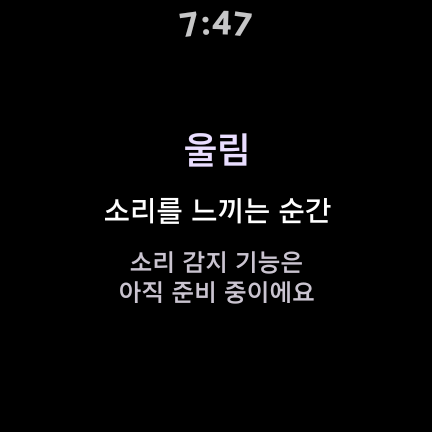

# #2 기초 앱 — 워치7 설치·실행 기록

2026-11-13 19:47 KST, 실제 Galaxy Watch7 SM-L300에서 확인했다. ADB 조회 결과 제조사 samsung, Android 17 / API 37, 물리 화면 432×432, `android.hardware.type.watch` 및 마이크 기능이 확인되었다. 개발자 무선 연결 주소와 페어링 코드·기기 고유 식별자는 기록하지 않는다.

## 빌드 대상과 결과

- 기능 소스 commit: `7118226c847d7567c0fabe977dd4e25884eb9891` (PR #41).
- Gradle 8.13 / AGP 8.13.2 / Kotlin 2.1.21 / Wear Material 3 1.5.0, minSdk 34 / compileSdk 36 / targetSdk 35. API 37 기기에서 해당 APK의 설치·실행이 성공해 SDK 설정은 그대로 유지했다.
- Windows, IntelliJ JBR 21, Android SDK Platform 36 / Build Tools 35.0.0.
- `./gradlew.bat :app:assembleDebug :app:lintDebug`: BUILD SUCCESSFUL in 16s (48 tasks executed).
- 이후 `./gradlew.bat :app:testDebugUnitTest :app:assembleDebug :app:lintDebug`: BUILD SUCCESSFUL in 2s. `testDebugUnitTest NO-SOURCE`: 실행된 단위 테스트는 0건이다.
- 이 PC에서 만든 `app/build/outputs/apk/debug/app-debug.apk`: 25,581,508 bytes, SHA-256 `a84b6c7b4cba02143c769126d1349cb3276ef61fa1083d8e5becbe42b426739c`. 이전 담당자의 다른 PC 빌드와 APK 해시는 다르며, 이번에 설치한 파일의 해시를 위와 같이 구분한다.

## 실제 설치와 실행

기존 `com.ullim.watch` 패키지가 없는 것을 먼저 확인했다. 다음 명령에서 `WATCH_SERIAL`은 연결된 워치 식별자를 대입한다.

```text
adb -s WATCH_SERIAL install -r app/build/outputs/apk/debug/app-debug.apk
Performing Streamed Install
Success

adb -s WATCH_SERIAL shell am start -W -n com.ullim.watch/.MainActivity
Status: ok
Activity: com.ullim.watch/.MainActivity
WaitTime: 3062
Complete
```

충전 대기 화면이 앱을 덮고 있어 화면을 깨운 뒤 다시 앱을 전면으로 가져왔다. 다시 실행한 결과 Status ok / WaitTime 9ms, `dumpsys window`의 현재 focus와 focused app 모두 `com.ullim.watch/.MainActivity`였다. 이는 앱 실행 명령 시간이며 음향→진동 지연 수치가 아니다.

아래 PNG는 해당 기기의 실제 캡처이며 울림 제목·문구·준비 중 안내가 원형 화면 안에 읽히는 것을 시각 확인했다. 호스트 미리보기나 합성 화면이 아니다.



## #2 완료 조건 판정

- [x] debug APK 생성 및 워치7 기본 화면 실행.
- [x] `settings.gradle.kts`의 `include(":app")` 한 개 앱. 모바일·서버 모듈 없음.
- [x] 로컬 빌드 명령과 실기기 설치·실행 결과 및 화면 기록.

이 기록은 **기초 화면**에만 해당한다. 마이크 수집, DSP, 실제 모터 출력, AI 추론, 백그라운드 감지 및 물리 지연은 이 APK에 없고 통과로 간주하지 않는다. GitHub Actions를 만들거나 실행하지 않았다.
