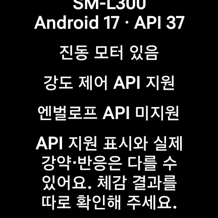

# #4 워치7 진동 기능 조사

2026-11-13 KST에 확인한 단일 Galaxy Watch7의 조사 기록이다. **API가 지원한다고 보고한 기능과 사용자가 실제 구별한 진동을 별도로 기록한다.** 이 표는 #18·#37·#39의 출력 품질 합격 증거가 아니다.

## 기기와 검증 대상

| 항목 | 확인값 |
|---|---|
| 기기 | Samsung Galaxy Watch7 SM-L300, 화면 432×432 |
| OS | Android 17 / API 37 / One UI 9 베타 |
| 펌웨어 | 업데이트 전 L300XXU2ZZI1 → 현재 L300XXU2ZZK1 |
| #4 로컬 검증 소스 | `c10cf9d11e65152ad1efce8f68b00a7b66f4af29` (#4 원본과 현재 main 병합) |
| 현재 설치된 누적 앱 소스 | `de71ba71775b064255fd4651db0ad505004d658f` (#35 UI 후보) |
| 현재 설치 APK | SHA-256 `952d2a0f823b16f2f728bb7bd7a8dfb12dc215478dcec92fd885910e683b84bb`, 52,702,374 bytes; 설치 후 기기 파일 해시도 확인 |

현재 실기기 화면은 **PR #43 단독 APK가 아니라 누적 앱**이다. `AndroidHapticProbe.kt`의 Git blob은 양쪽 모두 `5518d844b65f9b05e3195035ffa59f891f2b8da6`으로 동일하다. `HapticCapabilities.detect`도 동일하며, 실제 기기의 `amplitudeControl=true`에서 기본 약/중/강/길게/리듬 파형 및 `createWaveform(..., -1)` 전달 경로가 동일하다. 누적 앱에는 별도의 미지원 기기용 펄스 폴백과 A~H 비교 도구, 진단 화면 개선이 추가되어 있으므로 그 전체 UI를 PR #43의 실행 증거로 간주하지 않는다.

아래 기본 진단은 `vibrator.vibrate(effect)`로 속성을 별도 지정하지 않는다. A~H 비교는 동일한 `USAGE_TOUCH` 속성을 쓰는 별도 경로다. 서로 다른 경로의 체감 결과를 동일 조건의 실험으로 합치지 않는다.

## 기능 매트릭스

| 기능 | API/명령 또는 소스 확인 | 실제 워치 관찰 | 판정/제한 |
|---|---|---|---|
| 진동 권한/모터 | Manifest의 `VIBRATE`, `hasVibrator()` | 모터 있음; 진단 버튼에서 실제 진동 느낌 | 출력 존재 확인 |
| 강도 제어 | `hasAmplitudeControl()=true` | 같은 100ms의 약 60 / 중 130 / 강 220 버튼 모두 비슷하다는 사용자 답변 | **지원 플래그와 강도 구별은 불일치**; 강약 성공으로 처리하지 않음 |
| 엔벌로프 | API 37에서 `areEnvelopeEffectsSupported()=false` | 화면에 엔벌로프 API 미지원 표시 | 효과 생성/제어점 제한 조회를 진행하지 않음; 최대 점수·간격·길이는 N/A |
| 기본 단일 파형 | 약/중/강 100ms, 길게 600ms, 반복 없음 | 600ms는 사용자 표현으로 “매끈하게 지이잉”; 100ms 버튼들도 진동함 | 단일 긴 출력의 연속감 관찰; 길이 구별의 정량 평가 아님 |
| 기본 리듬 | 70ms 진동 3회, 그 사이 무음 100ms / 250ms, 전체 560ms | 현재 펌웨어에서 사용자 확인 요청 중 | 아래 추가 기록 전에는 세 번/간격 구별을 통과로 쓰지 않음 |
| 같은 길이의 전체 강도 범위 (#18 비교) | G=1 / H=255, 각각 단일 600ms, 같은 TOUCH 속성 | 업데이트 전과 ZZK1 업데이트 후 모두 비슷하다는 사용자 답변 | **실패 지속**; 극값 재조정이나 업데이트를 해결로 처리하지 않음 |
| 한 호출 내 강도 변화 (#18 비교) | E: 60→130→220, 각 600ms | 진동은 느끼지만 강도 차이는 없다는 사용자 답변 | 단계별 강도 표현 미검증/실패 관찰 |
| 연속 명령 교체 (#18 비교) | A: 단일 600ms / B: 한 호출의 30×20ms / C: 10×60ms 별도 호출 / D: 3×200ms 별도 호출; 같은 강도 | A·B 매끈, C 끊김, D 세 번이 느껴지고 C보다 덜 끊긴다는 사용자 답변 | 명령 경계/교체에 따른 연속성 문제 관찰; D 결과를 기본 70ms 리듬의 성공으로 전용하지 않음 |
| 겹치는 짧은 호출 (#18 비교) | F: 유한 600ms 비교, 60ms 간격의 겹치는 요청 | 사용자 답변상 거침 | 해결책으로 채택하지 않음 |
| 중지/실패 계약 | 중지 및 `onStop`에서 cancel; 조회 실패 시 `probeFailed=true`, 출력 버튼 비활성화; 출력 예외 시 실패 안내 | 정상 기기에서 조회 실패/출력 예외를 인위적으로 발생시키지 않음 | 소스·단위 테스트 근거; 실제 오류 주입 시험 아님 |
| 물리 반응 지연 | 소리 발생과 모터 반응을 함께 측정하는 외부 센서 기록 없음 | 실시간 앱 시작 반응이 빠르다는 사용자 정성 답변만 존재 | **미측정**; P95 또는 500ms 기준 합격으로 쓸 수 없음 |



스크린샷은 초점이 울림의 진단 Activity에 있는 것을 확인한 뒤 ADB로 얻은 원본 픽셀이다. 스크롤 화면의 일부이며 기기 모델 첫 줄은 위쪽에서 일부 잘린다. 다른 앱 화면이나 합성 이미지가 아니다.

## 재현 및 실패 해석

1. 마이크 감지를 중지한 상태에서 설정 → 진동 진단을 연다.
2. 모터/강도 API/엔벌로프 표시와 기기 OS를 확인한다. 지원되지 않는 엔벌로프의 제어점 제한은 기입하지 않는다.
3. 같은 길이의 약/중/강을 비교하고, 길게·리듬을 각각 분리해 시험한다. 이전 출력이 끝난 뒤 다음 버튼을 누른다.
4. API 지원, 앱 명령, 사용자 체감, 외부 센서 실측의 네 층을 구분한다. 명령 전송 성공은 실제 강약 성공이 아니다.
5. 물리 지연/강도/리듬의 최종 검증은 #18·#37에 정한 방법과 기준으로 별도 수행하며 실패 원인을 해결한 뒤 재시험한다.

단일 참여자의 알려진 버튼 비교다. 무작위 블라인드 정답률, 두 사람 각각 30회 이상의 시험, 물리 진동 센서 측정은 수행하지 않았다. 삼성 기본 설정의 약함/강함 미리보기는 구별된다는 별도 답변이 있으나 같은 길이/파형이 통제되지 않아 앱의 동일 길이 강도 제어 성공 증거는 아니다.

ZZK1에서도 G/H 체감이 같았고, 실제 펌웨어의 표준 파형 처리 경로에서 비영(非零) 강도 전달 호출이 빠진다는 읽기 전용 조사 결과가 있다. 자세한 #18 기록은 [PR #69](https://github.com/chlgusrbs0/ullim/pull/69)의 `docs/evidence/issue18-zzk1-regression.txt`와 비교 문서를 따른다. 이는 해당 베타 빌드의 관찰이며 모든 워치/펌웨어나 모터 자체의 불가능을 뜻하지 않는다. 시스템 JAR/DEX/전체 역어셈블리, 앱 APK, 원본 음성은 이 저장소에 포함하지 않는다.

## 로컬 회귀 검증

Windows PowerShell, JBR 21, Android SDK 36 / Build Tools 35.0.0, 저장소 Gradle Wrapper 8.13:

```text
./gradlew.bat :app:testDebugUnitTest :app:assembleDebug :app:lintDebug --console=plain
BUILD SUCCESSFUL in 21s
53 actionable tasks: 29 executed, 24 up-to-date
ContractsTest: 6, CapabilitiesTest: 5
합계 11 tests, 0 failures, 0 errors, 0 skipped
Lint: 0 errors, 4 warnings, 1 hint
```

API 34에서 엔벌로프 조회 생략, 모터 없음에서 고급 조회 생략, API 36의 제한 전달, 조회 예외 시 사용 불가 상태, 유한 파형/기본 강도 폴백을 단위 테스트로 검사했다. 가짜 probe의 `16 points` 등은 테스트용 값이며 워치 실측값이 아니다. 실제 Android probe는 엔벌로프 미지원 시 `envelopeEffectInfo`를 읽기 전에 반환한다. GitHub Actions는 사용하지 않았다.

## 완료 판단 경계

조사 이슈 #4의 검토 근거는 기능 탐지 구현, 실기기 지원 표시와 성공·실패를 분리한 표, 미지원 API 회피다. 기본 리듬의 추가 사용자 확인이 남아 있다. PR #43 전체 화면의 독립 설치 검증, 물리 지연 및 최종 품질 시험을 수행한 것으로 기록하지 않는다. 최종 촉각 표현의 강도/연속성 문제와 물리 지연 미측정은 계속 차단 항목이며 #18·#37·#39를 닫을 근거가 아니다.
