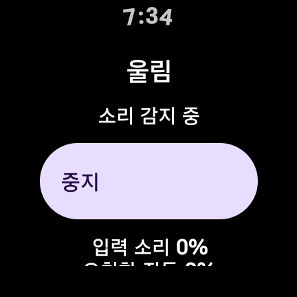
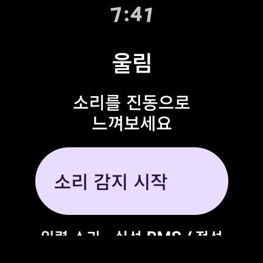

# 현재 설치본의 실제 화면 OFF 감지 (#6)

2026-11-14 Watch7 SM-L300/API37/L300XXU2ZZK1에서 현재 설치된 정상 패키지 com.ullim.watch를 시험했다. 제품 소스76d2c81/APK SHA256 `4b206f345b6660cdb89e23d57bc1b3965ac2970993f8ecc8abe6d08153a3efaa`, 기존 숫자 보정 `47a0c31418640333f4624240f37690f410d70423750ad7bb70675866b751f06c`를 사용했다. 설치/새 보정/권한 변경/설정 변경 없이 실제 메인 시작·중지 버튼을 조작했다. **원본 PR55/057ac84 그대로의 시험이 아니며 main/원본 PR의 합격을 소급 증명하지 않는다.**

## 실제 관찰

처음 입력은 화면이 잠든 상태여서 전달되지 않았다. 화면을 깨우고 MainActivity가 보이는 상태에서 다시 시작 버튼을 눌러 실제 마이크 AppOps running, foreground service types=0x80/notification1과 '소리 감지 중' 화면을 확인했다. 잠든 상태의 첫 입력을 정상 시작이나 앱 결함으로 기록하지 않는다.

화면을 끈 뒤 디스플레이 dump의 Display State/mScreenState가 OFF임을 확인했다. 단말은 Dozing이었다. 그 상태에서 약51초 간격7회, 총313204ms(5분13초) 동안 PID5120/세션1 유지, 마이크 running/foreground service 및 계속 진전되는 DSP 입력 수치를 관찰했다. 첫 관찰911ms부터 마지막313204ms까지 실제 관찰 간격은312293ms이고, 대응하는 오디오 표본 시간축은312500ms 진행했다. [수치7개](issue6-production-watch/background-observations.json), [화면 OFF 추가 관찰](issue6-production-watch/display-observations.jsonl).

| 관찰 | 경과 ms | 마이크/FGS | 마지막 표본 ns |
|---|---:|---|---:|
|0|911|running/foreground|22486956348889|
|1|52906|running/foreground|22538956348889|
|2|104991|running/foreground|22590956348889|
|3|156999|running/foreground|22642956348889|
|4|209037|running/foreground|22694956348889|
|5|261066|running/foreground|22746956348889|
|6|313204|running/foreground|22799456348889|

정숙 환경의 실제 입력 처리 시험이다. 사용자가 작은/큰 소리나 박수를 내지 않았고, AI는 원래 OFF였다. 저장한 각 관찰 구간25프레임의 요청 출력은0이었으므로 강약/진동 지속/리듬/소리 반응 시험으로 쓰지 않는다. 관찰은 주기 표본이며 모든 프레임의 무손실·물리 지연을 증명하지 않는다. 원음 대신 입력 에너지/시간/요청 집계 숫자만 저장했다.

## 중지·재시작

5분 관찰 뒤 화면을 깨워 실제 중지 버튼을 눌렀다. 시작 화면으로 돌아왔고 RECORD_AUDIO는 running이 아니며 서비스 목록nothing, CurrentVibration/NextVibration은null이었다. 43초 뒤에도 마이크/서비스가 다시 켜지지 않았다. 관찰 중 요청 출력은0이었으므로 이를 물리 모터 잔여 진동의 촉각 확인으로 바꾸지 않는다.

무선 연결 offline/closed와 호스트 호출 문제로 짧은 재시작의 초기 시도는 시작 전 실패했다. 이를 성공 재시작으로 집계하지 않았다. 연결을 복구한 뒤 새 세션2로 실제 시작, running/foreground 및 새 DSP 시간축을 확인하고 중지 버튼으로 끝냈다. 세션2 마이크 사용 기록2s704ms 뒤 비활성/서비스nothing을 확인했다. [세션2 숫자](issue6-production-watch/restart-session2.txt).

최종 보정 해시47a0c314…f06c/화면 유지 설정1/글씨1.0을 다시 확인했다. 무선 충전(mPlugType=4) 중 실제 mStayOn=false였으며, 관찰된 설정1이 이 상태에서 화면을 유지하지 않았다는 사실을 기록한다. 설정값을 바꾸거나0으로 복원하지 않았다. 시스템 전체 동작으로 일반화하지 않는다.

## 남은 범위

현재 통합본의 정숙5분 OFF 처리·일반 중지·짧은 재시작 근거다. 원본 PR55의 입력/종료 구현은 현재 설치본과 다르고, 후속 #23의 정리 장벽/비동기 중지 수정도 포함되지 않은 상태이므로 같은 시험을 통과했다고 간주하지 않는다. 잠금/AOD/앱 이탈/권한 회수/서비스 강제 종료·알림 액션, 통제 소리 반응과 물리 모터 중지, 다른 실패/재시작 경로는 여전히 남는다. #6/PR55와 관련 물리 인수 이슈를 이 자료만으로 머지·종료하지 않는다.

별도 .nativeprobe의 새 보정 실패/서비스 반복0회라는 [이전 결과](issue23-native-service-cycles.md)도 그대로 유지한다. 기존에 저장된 사용자 보정값으로 정상 앱을 실행한 이번 시험이 그 새 보정 실패를 성공으로 바꾸는 것은 아니다.

후속 AI 설정 UI 시험은 다른 시스템 화면으로 전환되어 중단했고 실제 AI ON 추론을 확인하지 못했다. 일반 중지/43초 비활성/세션2 중지가 확인된 이후의 별도 정리로 울림 프로세스만 force-stop했다. 이를 일반 중지나 자동 재시작 방지의 새 증거로 계산하지 않는다. 최종 프로세스/서비스 없음과 마이크 비활성, 설정 저장 파일 없음(files/profileInstalled만 유지), 보정47a0c314…f06c/화면 유지1/글씨1.0을 확인했다. 다음 실행의 기본 AI OFF/민감도100%를 바꾸는 저장은 없었다. 사용자 개인 시스템 화면은 증거로 게시하지 않았다.
